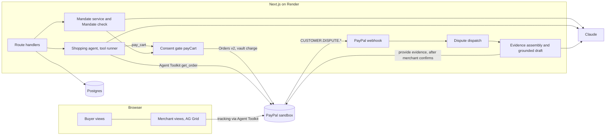

# Mandate

**Proof of what your agent was allowed to buy.**

A buyer writes a mandate in plain words. Their shopping agent can only pay inside it: every PayPal payment is checked against the signed, fingerprinted mandate first, and carries a reference to it. When a buyer later disputes an agent order, the merchant answers with that record.

Built for the [PayPal AI Hackathon](https://paypalaihackathon.devpost.com/). Sandbox only: no real money moves.

| | |
|---|---|
| Live demo | [mandate-thsn.onrender.com](https://mandate-thsn.onrender.com), kept online until Dec 15, 2026 |
| Demo video | [youtu.be/CUtU4nXVPLU](https://youtu.be/CUtU4nXVPLU), 2 minutes |
| Video | _Added at submission_ |
| License | [MIT](LICENSE) |

## Contents

1. [The problem](#the-problem)
2. [What Mandate does](#what-mandate-does)
3. [The consent gate](#the-consent-gate)
4. [Architecture](#architecture)
5. [PayPal APIs and the Agent Toolkit](#paypal-apis-and-the-agent-toolkit)
6. [How Claude is used](#how-claude-is-used)
7. [AG Grid](#ag-grid)
8. [Open a sandbox dispute](#open-a-sandbox-dispute)
9. [What we learned from the sandbox](#what-we-learned-from-the-sandbox)
10. [Setup](#setup)
11. [Environment variables](#environment-variables)
12. [Tests](#tests)
13. [Project status](#project-status)
14. [License](#license)

## The problem

Shopping agents already pay on behalf of people. When one of those purchases is disputed, nobody has settled who carries the cost.

- There is still no concrete chargeback liability rule for purchases made by AI agents, and card network and federal rules give no clean answer when a buyer says the agent bought something it was not allowed to. [Merchant Cost Consulting, Oct 10, 2026](https://merchantcostconsulting.com/?p=9509)
- A disputed agent purchase generally follows card not present rules, so the merchant bears the loss unless it wins the dispute. [Chargeflow, Jul 7, 2026](https://www.chargeflow.io/blog/ai-agent-chargeback-liability)
- The same article reports Mastercard research by Datos Insights projecting the global cost of chargebacks to merchants at $36.9 billion in 2026 and $46.1 billion in 2029, and notes that no public source reports a dispute rate for agent orders. [Chargeflow, Jul 7, 2026](https://www.chargeflow.io/blog/ai-agent-chargeback-liability)
- Chargeflow's evidence playbook tells merchants to keep, for each agent order, the customer's mandate: what was authorized, including the price cap, the merchants allowed and the expiry. [Chargeflow, Jul 19, 2026](https://www.chargeflow.io/blog/agentic-commerce-chargebacks-the-evidence-playbook-merchants-need)
- New York's acting Superintendent of Financial Services says that on agents, the department has been very focused on "where does liability sit?" [American Banker, Jun 26, 2026](https://www.americanbanker.com/payments/news/new-york-financial-regulator-zeroing-in-on-agentic-commerce)

The gap is between "authorized" and "intended". Mandate records the intent before the agent pays, enforces it at payment time, and hands it to the merchant when it matters.

## What Mandate does

**Buyer**

1. Writes instructions in plain words, for example "Buy running shoes, size 10, under $120, neutral colors, this week only".
2. Claude turns them into structured terms: total budget, currency, category, required and forbidden attributes, allowed stores, expiry, number of orders. The buyer edits anything, then signs.
3. Signing fixes the terms: a canonical JSON record is hashed with SHA256 together with the mandate code and version, and timestamped.
4. The buyer links a PayPal account once (PayPal Vault), so the agent can pay later without the buyer present.
5. A shopping agent searches three fictional stores, builds a cart and asks to pay. The Mandate check runs first. A compliant cart is paid through PayPal. A cart outside the mandate is blocked, with every failed term explained in words, and the buyer can widen the mandate (a new version, a new signature, a new hash), switch to a compliant alternative, or cancel.
6. The buyer can revoke the mandate at any time and download a receipt PDF with every signed version, check and order.

**Merchant** (the demo store Sample Sports Outlet)

1. Sees every agent order in an AG Grid view: mandate, fingerprint, check result, status, dispute state, with search, filters, grouping, master detail and export.
2. Adds shipment tracking, reported to PayPal through the Agent Toolkit.
3. When a buyer disputes an order, PayPal's webhook (signature verified with PayPal) starts the evidence file: the signed mandate, its fingerprint, the signature and check times, the term by term check, the order and the tracking. A factual draft response comes with it.
4. The merchant includes or excludes each item, edits the response, confirms an accuracy statement, and only then submits to PayPal.

No account is needed: each visitor gets a private demo session (a signed cookie) and can switch between the buyer and merchant views.

## The consent gate

One function in the codebase can make PayPal move money: `payCart` in [`lib/payments/gate.ts`](lib/payments/gate.ts). It:

1. takes only ids from its caller: no amount, no verdict, no terms;
2. locks the mandate row (`SELECT ... FOR UPDATE`), so two carts cannot share the remaining budget or order count, and a revocation cannot slip in between;
3. re reads the cart, the pinned mandate version and the catalog prices under that lock, and recomputes the total and the fingerprint itself;
4. runs the deterministic Mandate check ([`lib/check/run.ts`](lib/check/run.ts)): status, expiry, total and currency, category, required and forbidden attributes, store allowlist, remaining orders. Numbers are compared by code only. The model is used for one kind of term, free text preferences such as "comfortable for long runs", and a missing or unclear verdict fails closed;
5. charges the vaulted PayPal account with the check id as `PayPal-Request-Id` and `CODE:version:sha256` in `custom_id`;
6. checks again before any separate capture.

The bypass suite in [`tests/bypass/`](tests/bypass/) tries to get around it: totals and verdicts supplied by the caller, tampered terms or canonical records in the database, carts pinned to a superseded version, carts from another session or another store, parallel payments racing for the last order or the budget, raw money tools requested by name, and a static scan proving no file outside `lib/payments` imports the PayPal transport. A revocation racing a capture is covered in [`tests/contract/history-routes.test.ts`](tests/contract/history-routes.test.ts).

## Architecture



| Layer | Choice |
|---|---|
| App | Next.js 16 App Router, React 19, TypeScript strict |
| Data | Postgres (Render Postgres in production, PGlite locally and in tests), Drizzle ORM |
| Payments | PayPal Orders v2, Vault v3, Customer Disputes v1, Webhooks, JS SDK v6, Agent Toolkit |
| Model | Claude `claude-sonnet-5-5` through the official `@anthropic-ai/sdk` |
| Merchant grid | AG Grid Enterprise 36 |
| PDFs | pdf-lib with standard fonts (receipt and evidence report) |
| Tests | Vitest (unit, contract, bypass), Playwright (desktop and Pixel 7) |
| Hosting | Render web service and Render Postgres, from [`render.yaml`](render.yaml) |
| Background jobs | Render Workflows task `assembleEvidence` ([`workflows/`](workflows/)), with the app as a safety net |

Key folders: `lib/check` (the Mandate check), `lib/payments` (gate, PayPal clients, toolkit wrapper, webhooks, disputes), `lib/mandate` (terms, canonical record, drafting, amendments, revocation, receipt), `lib/agents` (shopping and merchant agents), `lib/disputes` (evidence items, grounded draft, pool, submission, report), `app/api` (routes), `components` (UI from the design canvas), `specs/001-agent-purchase-mandates` (spec, plan, contracts, tasks).

### Evidence assembly on Render Workflows

When a verified dispute event arrives, the webhook records it and starts the `assembleEvidence` task on Render Workflows ([`workflows/assemble-evidence.ts`](workflows/assemble-evidence.ts)), with the dispute id as input and an idempotency key, then answers PayPal at once. The task builds the evidence file and the grounded draft with Render's retries (3, exponential backoff) and a 5 minute timeout, on its own compute. The app keeps a safety net ([`lib/disputes/queue.ts`](lib/disputes/queue.ts)): if the run cannot be started, or no evidence file exists two minutes later, it assembles the file itself. Assembly is idempotent, one file per dispute, and the file records which path built it (`assembled_by`: `workflow` or `inline`). `/api/health` reports the active mode.

## PayPal APIs and the Agent Toolkit

| Need | Used | Why this one |
|---|---|---|
| Save the buyer's PayPal for later agent payments | Vault v3 setup tokens and payment tokens, JS SDK v6 save flow | The agent pays without the buyer present |
| Charge inside the mandate | Orders v2 with `payment_source.paypal.vault_id`, `stored_credential` (merchant initiated, unscheduled), `payee` per store, `custom_id` with the mandate reference | Money moves only from the gate, never from a toolkit tool |
| Agent reads order state | Agent Toolkit `get_order` | Read only, safe to hand to the agent |
| Merchant reports shipments | Agent Toolkit `create_shipment_tracking`, `get_shipment_tracking` | Tracking strengthens fulfillment evidence |
| Merchant reads cases | Agent Toolkit `list_disputes`, `get_dispute` | The merchant agent checks the case before drafting |
| Dispute notifications | Webhooks with `verify-webhook-signature` | Nothing is acted on before PayPal confirms the signature |
| Submit evidence | Customer Disputes v1 `provide-evidence` (multipart: the evidence report PDF as `BILLING_AGREEMENT`, tracking as `PROOF_OF_FULFILLMENT`, the response as notes) | Not in the toolkit |
| Revoke | Vault v3 delete payment token | Revocation removes the agent's ability to pay |

Money moving toolkit tools (`create_order`, `pay_order`, `create_refund`, `accept_dispute_claim` and the invoice and subscription writers) are never registered with the agent and are refused by name ([`lib/payments/toolkit.ts`](lib/payments/toolkit.ts)). A unit test enumerates the agent's tools and fails if one appears.

## How Claude is used

All calls go through one wrapper ([`lib/ai/model.ts`](lib/ai/model.ts)) that counts each call against a cap of 40 per demo session per day and a global daily cap, before the request is sent. Output is data, never a decision on a number.

| Where | What Claude does | Guard |
|---|---|---|
| New mandate ([`lib/mandate/draft.ts`](lib/mandate/draft.ts)) | Turns plain words into structured terms, with stated assumptions | Structured output validated with zod; the buyer reviews and signs; nothing is paid from a draft |
| Mandate check ([`lib/check/semantic.ts`](lib/check/semantic.ts)) | Judges free text preferences only | A missing or unclear verdict fails closed |
| Shopping agent ([`lib/agents/shopping.ts`](lib/agents/shopping.ts)) | Searches the catalog, presents options, fills the cart, asks to pay, through the SDK tool runner | Tools: `search_catalog`, `present_options`, `add_to_cart`, `check_cart`, `pay_cart`, `order_status`, `get_order`. `pay_cart` calls the gate; no tool moves money any other way |
| Dispute draft ([`lib/agents/merchant.ts`](lib/agents/merchant.ts)) | Writes the response from the evidence file, tagging each sentence with the items it rests on | The server keeps only sentences whose items are included and whose numbers and ids appear in those items' facts ([`lib/disputes/draft.ts`](lib/disputes/draft.ts)); missing records are stated in fixed wording; the merchant edits and confirms before anything is sent |

Refusals use the server side fallback; a refusal or an unparsable answer falls back to the manual path (drafting) or a fixed template (disputes).

## AG Grid

The merchant view ([`components/merchant/grid/`](components/merchant/grid/)) uses AG Grid Enterprise:

- theme built from the design tokens with the Theming API (`themeQuartz.withParams`);
- custom cell renderers: status tag, mandate id with its fingerprint, mandate state, check score, PayPal id;
- quick search, set filters, a mandate state filter, sorting;
- row grouping by status, mandate state or day, from a select or the group panel;
- master detail with the mandate terms, the check table, tracking and a link to the dispute;
- status bar with totals, side bar with columns and filters;
- CSV and Excel export of exactly the rows shown.

AG Studio insights and the Studio agent are planned with the trial license.

## Open a sandbox dispute

Judges get a ready dispute from the demo pool when they open **Disputes** in the merchant view. When every pool dispute has been answered, the page shows one read only and links here. To open a new one yourself (steps confirmed in the sandbox on Oct 25, 2026):

1. In the demo, create a mandate, link PayPal with the sandbox buyer from the testing instructions, and let the agent buy an item from **Sample Sports Outlet** (the merchant view shows that store).
2. In a private browser window, sign in to the [PayPal sandbox](https://www.sandbox.paypal.com) as the same sandbox buyer. The store appears there as **Test Store**, the sandbox business account's default name.
3. Open the [Resolution Center](https://www.sandbox.paypal.com/resolutioncenter), choose the payment and **Report a problem**. Because the agent paid with a saved PayPal, PayPal first shows "You have an automatic payment set up with Test Store": do **not** use *Manage Automatic Payments* (it cancels the agent's link); choose **Report Issue to PayPal**.
4. Pick a reason. With "I didn't authorize this transaction", PayPal first asks the buyer to secure the account: choose **Secure Your Account** and set a new password (*Skip this* blocks the sandbox buyer). Then submit.
5. About ten minutes later PayPal creates the case (id `PP-R-...`, waiting for the seller) and sends `CUSTOMER.DISPUTE.CREATED` to the app. The order shows **In dispute** in the merchant grid, with its evidence file and draft, and the case joins the pool.
6. If a case ever sits **Under review** before the seller is asked for evidence, the operator runs `pnpm pool:sync --apply`, which calls the sandbox only `require-evidence` and adds the case to the pool. It was not needed in our runs.

## What we learned from the sandbox

Every finding below comes from runs against real sandbox accounts on Oct 24 and 25, 2026; the dated log is [`scripts/LEARNINGS.md`](scripts/LEARNINGS.md) and the scripts are in [`/scripts`](scripts).

**The agent can pay without the buyer, once PayPal is linked.** A setup token with `usage_type: MERCHANT` and `usage_pattern: UNSCHEDULED_PREPAID`, approved once by the buyer, becomes a payment token. Merchant initiated orders with `vault_id` and `stored_credential` then complete in a single call (status COMPLETED, no separate capture), to each of the three stores through `payee`, with `custom_id` kept on the order and on the capture. The per payment approval fallback we had planned was not needed.

**Idempotency holds.** Replaying an order or a capture with the same `PayPal-Request-Id` returns the stored result: no second order, no second charge. A replayed id also returns a stored failure, so a retry after an error needs a new id.

**Ownership decides what an app may do.** Tracking and disputes belong to the merchant that received the money. With the REST app owned by one business account and the money routed by `payee` to another, `create_shipment_tracking` is refused (`USER_NOT_AUTHORIZED`). The demo's REST app is therefore owned by Sample Sports Outlet, the store of the merchant view. A saved PayPal also belongs to the merchant whose app created it: another app gets `PERMISSION_DENIED` when charging it.

**One unticked box blocks the whole Vault.** Until "Save payment methods" is ticked in the app's features, every Vault call answers `403 NOT_AUTHORIZED`, card and PayPal alike, although the OAuth scopes look fine.

**Revocation also works at PayPal.** After `DELETE /v3/vault/payment-tokens/{id}`, the token reads 404 and any charge with it is refused, on top of the consent gate's own refusal.

**The Agent Toolkit does not throw.** It returns PayPal errors as content (`{"errors": [...]}` or `{"ok": false}`), so a refused call can look like a success. Our wrapper now turns those into errors; before that, the tracking screen could have said "reported to PayPal" for a refused call. The toolkit's PayPal server SDK also needs `tslib` 2 but lists it only as a development dependency; with pnpm it resolved `tslib` 1 and crashed until a package extension gave it the right version.

**Webhooks verify, tunnels expire.** Real `PAYMENT.CAPTURE.COMPLETED` and `CUSTOMER.DISPUTE.*` events pass `verify-webhook-signature`. A local quick tunnel expired overnight and the dispute events were lost; updating the webhook URL and calling the resend endpoint delivered them again, still verifiable. The hosted demo uses its stable Render address.

**Render Workflows picks up the assembly in seconds.** On the hosted demo, a verified dispute event started the `assembleEvidence` task and the workflow had built the evidence file 4 seconds later. Values marked `sync: false` in a Blueprint are only asked for at creation, so keys for a service added later are set by hand.

**Disputes take a while and change shape.** The buyer's report became a merchant visible case about ten minutes later, in the chargeback stage, due ten days later. Before the response, the case lists the evidence PayPal requests (`REQUESTED_FROM_SELLER`). `provide-evidence` with a JSON `input` part and the evidence report PDF was accepted: the case moved to **Under review** with one evidence submitted by the seller, the PDF and the 1,439 character response. PayPal filed it as `OTHER` although it was sent as `BILLING_AGREEMENT`.

## Setup

Requirements: Node 20.9 or later, pnpm 9.

```bash
git clone https://github.com/Chinorab/mandate.git
cd mandate
pnpm install
cp .env.example .env.local
```

Fill `.env.local` (see below; [docs/sandbox-setup.md](docs/sandbox-setup.md) walks through the PayPal sandbox accounts, app, Vault and webhook). Then:

```bash
pnpm db:migrate
pnpm db:seed
pnpm dev
```

The app runs on http://localhost:3000. Without `DATABASE_URL`, it uses an embedded Postgres (PGlite) in `.data/pglite`. Without PayPal keys, mandates can be drafted and signed but not linked or paid; without an Anthropic key, drafting falls back to the manual form and dispute drafts use the fixed template.

## Environment variables

All secrets stay on the server. The only values that reach the browser are the AG Grid license key, which AG Grid designs to ship in the bundle, and the short lived PayPal client token issued per checkout.

| Variable | Required | Purpose |
|---|---|---|
| `PAYPAL_CLIENT_ID`, `PAYPAL_CLIENT_SECRET` | For payments | Sandbox REST app credentials |
| `PAYPAL_WEBHOOK_ID` | For disputes | Id of the sandbox webhook, used to verify signatures |
| `PAYPAL_MERCHANT_ID_SPORTS_OUTLET`, `PAYPAL_MERCHANT_ID_RUNNING_CO`, `PAYPAL_MERCHANT_ID_SHOE_SUPPLY` | For payments | Sandbox business accounts paid through `payee`, one per store |
| `ANTHROPIC_API_KEY` | For model features | Claude API key; set a monthly spend limit on it |
| `MODEL_DAILY_GLOBAL_CAP` | No | Global daily model call cap (default 2000) |
| `DATABASE_URL` | In production | Postgres URL; empty means PGlite |
| `SESSION_SECRET` | In production | 32 or more random bytes, signs the demo session cookie |
| `NEXT_PUBLIC_AG_GRID_LICENSE_KEY` | No | AG Grid Enterprise license; unset shows a watermark |
| `AG_STUDIO` | No | AG Studio license, for the insights page |
| `RENDER_API_KEY`, `RENDER_WORKFLOW_SLUG` | No | Start the evidence assembly on Render Workflows (the slug is wired by `render.yaml`); without them the app assembles the file itself |
| `E2E_BASE_URL`, `E2E_PAYPAL_BUYER_EMAIL`, `E2E_PAYPAL_BUYER_PASSWORD` | Local tests | Playwright target and sandbox buyer |
| `MANDATE_DEV_SCENARIOS` | Local tests | `1` enables development fixtures; ignored outside `NODE_ENV=development` |

`pnpm scan:secrets` scans the tree for secret shapes and for any value from local env files; the pre push hook runs it.

## Tests

```bash
pnpm typecheck
pnpm lint
pnpm test
E2E_BASE_URL=http://localhost:3000 pnpm e2e
```

- `tests/bypass`: attempts to pay outside the mandate (the consent gate must refuse every one).
- `tests/contract`: every route handler, webhook verification, dispute submission guards, evidence latency.
- `tests/unit`: canonical record and fingerprint, the Mandate check, pricing, grounding of dispute drafts, landing sources.
- `tests/e2e`: every buyer and merchant journey on desktop and on a Pixel 7 viewport. End to end tests use development fixtures, enabled by `MANDATE_DEV_SCENARIOS=1` in `.env.development.local`, so they run without PayPal or model keys.

## Project status

Done and tested: mandate drafting, signing and verification, the consent gate and its bypass suite, the shopping agent, blocked carts and amendments, revocation, history and receipts, the AG Grid merchant view, the dispute flow from webhook to submission, the landing and privacy pages.

Run end to end in the PayPal sandbox: linking PayPal from the app, the agent paying without the buyer, webhook verification, a real dispute answered from the dispute page and accepted by PayPal. Hosted on Render at https://mandate-thsn.onrender.com (web service and Render Postgres from [`render.yaml`](render.yaml), webhook pointed at it, uptime checked every 30 minutes by [a workflow](.github/workflows/uptime.yml)). Still to come: AG Studio insights (trial license).

The spec driven record of the work is in [`specs/001-agent-purchase-mandates`](specs/001-agent-purchase-mandates) and the project principles in [`.specify/memory/constitution.md`](.specify/memory/constitution.md).

## License

[MIT](LICENSE). Products, stores and orders in the demo are fictional. PayPal is a trademark of its owner; Mandate is not affiliated with PayPal.
